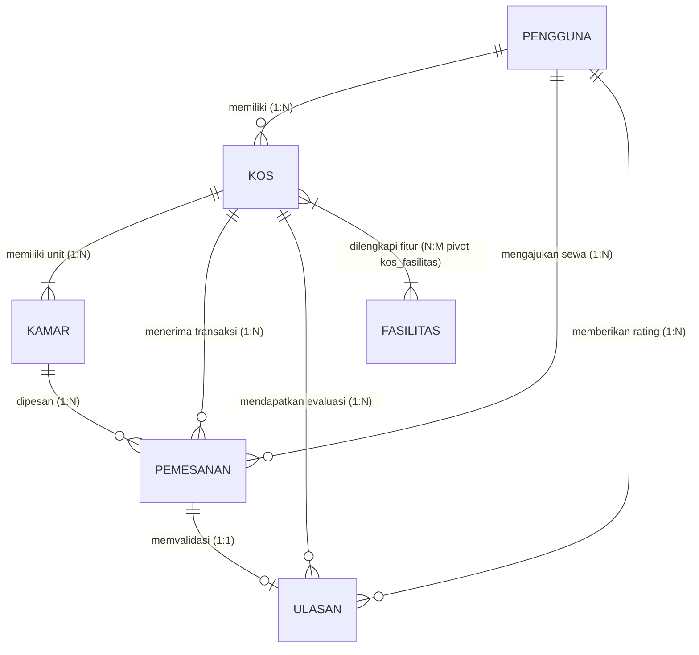

# Rancangan & Spesifikasi RESTful API KosKu (v1)

Dokumen ini memuat spesifikasi teknis dan standar rancangan antarmuka pemrograman aplikasi (REST API) untuk sistem pencarian dan manajemen indekos **KosKu**.

---

## A. Identitas

- **Nama Project**: KosKu &mdash; Platform Pencarian & Sewa Kos Terintegrasi
- **Anggota Kelompok**:
  1. **Sigit Pratama** (`Tamaaa21` )
  2. **Naufal Miftahul Arsyi** (`Naufal-Arsyi`)
  3. **Nurul Salma Afifah** (`nurulsalmaafifah-oss`)
  4. **Putri Areka Sandra** (`arekaa333-ux`)
- **Base URL**:
  - **Development / Lokal**: `http://localhost:8000/api/v1`
  - **Production**: `https://api.kosku.id/api/v1`
- **Versi API**: `v1` (disematkan sebagai prefix URI: `/api/v1`)
- **Bahasa Penamaan yang Dipilih**:
  - **URI & Resource Endpoints**: Menggunakan **Bahasa Inggris jamak (*Plural Nouns*)** sesuai konvensi industri RESTful API global (contoh: `/kos`, `/rooms`, `/bookings`, `/reviews`, `/facilities`, `/users`, `/uploads/images`). Tersedia pula rute alias berbahasa Indonesia untuk menjamin kompatibilitas ke belakang (*backward compatibility*).
  - **Atribut & Payload JSON**: Menggunakan format `snake_case` berbahasa Indonesia yang selaras dengan skema relasional basis data inti aplikasi (contoh: `nama_kamar`, `total_harga`, `durasi_sewa`, `tanggal_pemesanan`, `rating_rata_rata`).

---

## B. Resource & Relasi

Sistem KosKu mengelola 6 resource utama dengan atribut, tipe data, dan relasi sebagai berikut:

### 1. `Pengguna` (Users)
Representasi identitas pengguna sistem yang terbagi atas tiga peran (*role*): pencari, pemilik, dan admin.
- `id` : `BigInteger` (Primary Key, Auto Increment)
- `nama` : `String(150)` (Nama lengkap pengguna)
- `email` : `String(255)` (Alamat surat elektronik, Unik)
- `telepon` : `String(30)` (Nomor telepon/WhatsApp aktif, Nullable)
- `password` : `String(255)` (Hash bcrypt kata sandi)
- `role` : `Enum('pencari', 'pemilik', 'admin')` (Peran pengguna)
- `aktif` : `Boolean` (Status aktif akun, Default: `true`)
- `foto` : `String(255)` (URL foto profil/avatar pengguna, Nullable)
- `created_at` : `Timestamp`
- `updated_at` : `Timestamp`

### 2. `Kos` (Properties)
Representasi properti indekos yang ditawarkan oleh mitra pemilik kos.
- `id` : `BigInteger` (Primary Key, Auto Increment)
- `pemilik_id` : `BigInteger` (Foreign Key ke `pengguna.id`)
- `nama` : `String(200)` (Nama properti kos)
- `alamat` : `Text` (Alamat fisik lengkap)
- `deskripsi` : `Text` (Penjelasan rinci properti, Nullable)
- `jenis` : `Enum('putra', 'putri', 'campur')` (Kategori jenis hunian)
- `harga` : `Integer` (Tarif sewa bulanan dasar terendah)
- `harga_harian` : `Integer` (Tarif sewa per hari, Nullable)
- `harga_mingguan` : `Integer` (Tarif sewa per minggu, Nullable)
- `durasi_sewa` : `JSON` (Opsi tipe sewa yang didukung, contoh: `["harian", "mingguan", "bulanan"]`)
- `latitude` : `Decimal(10,8)` (Titik koordinat lintang GPS, Nullable)
- `longitude` : `Decimal(11,8)` (Titik koordinat bujur GPS, Nullable)
- `rating_rata_rata` : `Decimal(3,2)` (Agregat rating terdenormalisasi, Default: `0.00`)
- `ulasan_count` : `Integer` (Jumlah total ulasan terdenormalisasi, Default: `0`)
- `peraturan` : `JSON` (Array daftar aturan tata tertib kos)
- `foto` : `JSON` (Array URL foto galeri kos)
- `created_at` : `Timestamp`
- `updated_at` : `Timestamp`

### 3. `Kamar` (Rooms)
Representasi unit kamar individual yang berada di dalam suatu properti kos.
- `id` : `BigInteger` (Primary Key, Auto Increment)
- `kos_id` : `BigInteger` (Foreign Key ke `kos.id`)
- `nama_kamar` : `String(100)` (Nomor/nama identitas kamar)
- `harga` : `Integer` (Tarif sewa bulanan kamar)
- `harga_harian` : `Integer` (Tarif sewa harian kamar, Nullable)
- `harga_mingguan` : `Integer` (Tarif sewa mingguan kamar, Nullable)
- `durasi_sewa` : `JSON` (Tipe durasi sewa yang diperbolehkan pada kamar ini)
- `status` : `Enum('tersedia', 'terisi')` (Status ketersediaan sewa)
- `ukuran` : `String(50)` (Dimensi ruang kamar, contoh: "3x4 m", Nullable)
- `foto` : `JSON` (Array URL foto spesifik unit kamar)
- `fasilitas_kamar` : `JSON` (Array fasilitas bawaan unit kamar)
- `created_at` : `Timestamp`
- `updated_at` : `Timestamp`

### 4. `Pemesanan` (Bookings)
Representasi transaksi sewa kamar antara pencari kos dan pemilik.
- `id` : `BigInteger` (Primary Key, Auto Increment)
- `pengguna_id` : `BigInteger` (Foreign Key ke `pengguna.id` - Penyewa)
- `kos_id` : `BigInteger` (Foreign Key ke `kos.id`)
- `kamar_id` : `BigInteger` (Foreign Key ke `kamar.id`)
- `tanggal_pemesanan` : `Date` (Tanggal awal mulai sewa)
- `durasi_tipe` : `Enum('harian', 'mingguan', 'bulanan')` (Satuan durasi sewa)
- `durasi_jumlah` : `Integer` (Kuantitas satuan sewa, Default: `1`)
- `tanggal_selesai` : `Date` (Tanggal akhir sewa yang dihitung otomatis)
- `total_harga` : `Integer` (Total tagihan sewa yang dihitung otomatis)
- `status` : `Enum('menunggu', 'disetujui', 'ditolak', 'dibatalkan', 'selesai')`
- `created_at` : `Timestamp`
- `updated_at` : `Timestamp`

### 5. `Ulasan` (Reviews)
Representasi penilaian dan pengalaman sewa dari pencari yang telah disetujui.
- `id` : `BigInteger` (Primary Key, Auto Increment)
- `pengguna_id` : `BigInteger` (Foreign Key ke `pengguna.id`)
- `kos_id` : `BigInteger` (Foreign Key ke `kos.id`)
- `pemesanan_id` : `BigInteger` (Foreign Key ke `pemesanan.id`, Nullable)
- `rating` : `Integer` (Skor bintang kepuasan: skala 1 - 5)
- `komentar` : `Text` (Deskripsi narasi ulasan)
- `created_at` : `Timestamp`
- `updated_at` : `Timestamp`

### 6. `Fasilitas` (Amenities)
Representasi master fasilitas bersama (umum) yang disediakan pada kos.
- `id` : `BigInteger` (Primary Key, Auto Increment)
- `nama` : `String(100)` (Nama fasilitas, contoh: "WiFi Cepat", "AC", "Dapur")
- `deskripsi` : `String(255)` (Penjelasan fasilitas, Nullable)
- `created_at` : `Timestamp`
- `updated_at` : `Timestamp`

### Ringkasan Relasi & Diagram ERD (Mermaid)



---

## C. Endpoint Matrix

Daftar matriks endpoint API KosKu (26 endpoint terstruktur):

| No | HTTP Method | URI | Fungsi / Deskripsi | Aktor (Role) | Status Sukses | Status Gagal |
|---|-------------|-----|--------------------|--------------|---------------|--------------|
| 1 | `POST` | `/api/v1/auth/register` | Mendaftarkan akun pengguna baru | Publik | `201 Created` | `422 Unprocessable` |
| 2 | `POST` | `/api/v1/auth/login` | Otentikasi & penerbitan Bearer Token | Publik | `200 OK` | `422 Unprocessable`, `403 Forbidden` |
| 3 | `POST` | `/api/v1/auth/logout` | Mencabut token sesi aktif pengguna | Authenticated | `200 OK` | `401 Unauthorized` |
| 4 | `GET` | `/api/v1/me` | Mengambil detail profil user yang sedang login | Authenticated | `200 OK` | `401 Unauthorized` |
| 5 | `PUT` | `/api/v1/me` | Memperbarui nama dan nomor telepon | Authenticated | `200 OK` | `401 Unauthorized`, `422 Unprocessable` |
| 6 | `POST` | `/api/v1/me/avatar` | Mengunggah foto profil baru pengguna | Authenticated | `200 OK` | `401 Unauthorized`, `422 Unprocessable` |
| 7 | `PUT` | `/api/v1/me/password` | Memperbarui kata sandi pengguna | Authenticated | `200 OK` | `401 Unauthorized`, `422 Unprocessable` |
| 8 | `GET` | `/api/v1/kos` | Mengambil katalog kos dengan filter, search, & sort | Publik | `200 OK` | `500 Server Error` |
| 9 | `GET` | `/api/v1/kos/{id}` | Menampilkan detail lengkap properti kos | Publik | `200 OK` | `404 Not Found` |
| 10 | `POST` | `/api/v1/kos` | Mendaftarkan properti kos baru | `pemilik` | `201 Created` | `401 Unauthorized`, `403 Forbidden`, `422 Unprocessable` |
| 11 | `PUT` | `/api/v1/kos/{id}` | Memperbarui data properti kos | `pemilik` (milik sendiri), `admin` | `200 OK` | `401 Unauthorized`, `403 Forbidden`, `404 Not Found`, `422 Unprocessable` |
| 12 | `DELETE` | `/api/v1/kos/{id}` | Menghapus properti kos | `pemilik` (milik sendiri), `admin` | `204 No Content` / `200 OK` | `401 Unauthorized`, `403 Forbidden`, `404 Not Found` |
| 13 | `GET` | `/api/v1/kos/{id}/rooms` | Melihat daftar kamar pada kos tertentu | Publik | `200 OK` | `404 Not Found` |
| 14 | `POST` | `/api/v1/kos/{id}/rooms` | Menambah kamar baru ke dalam kos | `pemilik` (milik sendiri) | `201 Created` | `401 Unauthorized`, `403 Forbidden`, `404 Not Found`, `422 Unprocessable` |
| 15 | `PUT` | `/api/v1/rooms/{id}` | Memperbarui tarif, ukuran, atau status kamar | `pemilik` (milik sendiri), `admin` | `200 OK` | `401 Unauthorized`, `403 Forbidden`, `404 Not Found`, `422 Unprocessable` |
| 16 | `DELETE` | `/api/v1/rooms/{id}` | Menghapus unit kamar | `pemilik` (milik sendiri), `admin` | `204 No Content` / `200 OK` | `401 Unauthorized`, `403 Forbidden`, `404 Not Found`, `422 Unprocessable` |
| 17 | `POST` | `/api/v1/bookings` | Mengajukan sewa kamar dengan pencegahan double booking | `pencari` | `201 Created` | `401 Unauthorized`, `403 Forbidden`, `409 Conflict`, `422 Unprocessable` |
| 18 | `GET` | `/api/v1/bookings` | Mengambil riwayat / daftar pemesanan sewa | Authenticated (`pencari`, `pemilik`, `admin`) | `200 OK` | `401 Unauthorized` |
| 19 | `GET` | `/api/v1/bookings/{id}` | Melihat rincian detail pemesanan sewa | `pencari` (pemesan), `pemilik` (kos terkait), `admin` | `200 OK` | `401 Unauthorized`, `403 Forbidden`, `404 Not Found` |
| 20 | `PATCH` | `/api/v1/bookings/{id}/status` | Mengubah status pemesanan (setujui / tolak / batalkan) | `pencari` (hanya batal), `pemilik` & `admin` (setuju/tolak) | `200 OK` | `401 Unauthorized`, `403 Forbidden`, `404 Not Found`, `409 Conflict`, `422 Unprocessable` |
| 21 | `GET` | `/api/v1/kos/{id}/reviews/eligibility` | Memeriksa kelayakan pengguna menulis ulasan | `pencari` | `200 OK` | `401 Unauthorized` |
| 22 | `POST` | `/api/v1/kos/{id}/reviews` | Mengirimkan ulasan & skor bintang kos | `pencari` (sewa disetujui) | `200 OK` / `201 Created` | `401 Unauthorized`, `403 Forbidden`, `422 Unprocessable` |
| 23 | `GET` | `/api/v1/facilities` | Mengambil daftar fasilitas umum kos | Publik | `200 OK` | `500 Server Error` |
| 24 | `POST` | `/api/v1/uploads/images` | Mengunggah gambar batch (maks 5 file, 2MB per file) | `pemilik`, `admin` | `201 Created` | `401 Unauthorized`, `403 Forbidden`, `422 Unprocessable` |
| 25 | `GET` | `/api/v1/admin/users` | Mengambil daftar seluruh pengguna sistem | `admin` | `200 OK` | `401 Unauthorized`, `403 Forbidden` |
| 26 | `PATCH` | `/api/v1/admin/users/{id}/status` | Mengaktifkan / menonaktifkan status akun user | `admin` | `200 OK` | `401 Unauthorized`, `403 Forbidden`, `404 Not Found`, `422 Unprocessable` |

---

## D. Desain Query

Desain parameter query (filter, search, sort, pagination) diimplementasikan secara komprehensif pada endpoint koleksi:

### 1. Endpoint Koleksi 1: `GET /api/v1/kos` (Katalog Pencarian Kos)

- **Search (`q`)**:
  - Parameter: `q` (`string`, opsional).
  - Mekanisme: Melakukan pencarian teks berbasis `LIKE %q%` terhadap kolom `nama` kos ATAU kolom `alamat`.
- **Filter**:
  - `lokasi` (`string`): Filter pencocokan parsial alamat kota/kabupaten.
  - `harga_min` (`integer`, min: 0): Batas minimum tarif bulanan dasar.
  - `harga_max` (`integer`, min: 0): Batas maksimum tarif bulanan dasar.
  - `jenis` (`string`, pilihan: `putra`, `putri`, `campur`): Filter kategori jenis hunian.
  - `fasilitas` (`array` integer ID, contoh: `fasilitas[]=1&fasilitas[]=2`): Filter kos yang harus memiliki **seluruh** fasilitas yang dipilih (AND query across relation).
  - `tersedia` (`boolean` / `1` / `true`): Hanya menampilkan kos yang memiliki unit kamar dengan `status = 'tersedia'`.
  - `pemilik_id` (`integer`): Menyaring kos milik mitra pemilik tertentu (digunakan pada dashboard pemilik).
- **Sort (`sort`)**:
  - `harga_asc`: Mengurutkan tarif kos dari yang termurah ke termahal.
  - `harga_desc`: Mengurutkan tarif kos dari yang termahal ke termurah.
  - `id_asc`: Mengurutkan ID kos terkecil ke terbesar.
  - `latest`: Mengurutkan kos yang paling baru didaftarkan (`created_at` menurun).
  - **Nilai Bawaan (Default)**: Jika parameter `pemilik_id` diisi maka default `id_asc`; selain itu default `latest`.
- **Pagination**:
  - `page`: Nomor halaman aktif (integer, default: `1`).
  - `per_page`: Jumlah item per halaman (integer, default: `12`, batas minimum: `1`, batas maksimum: `100`).

### 2. Endpoint Koleksi 2: `GET /api/v1/bookings` (Daftar Riwayat & Pengajuan Sewa)

- **Implicit Role Scoping (Filter Otomatis Berbasis Aktor)**:
  - Role `pencari`: Query otomatis dibatasi hanya menampilkan transaksi miliknya (`pengguna_id = auth()->id()`).
  - Role `pemilik`: Query otomatis dibatasi hanya menampilkan transaksi pemesanan pada properti kos miliknya (`kos.pemilik_id = auth()->id()`).
  - Role `admin`: Tidak dibatasi (dapat menginspeksi seluruh transaksi sewa sistem).
- **Search (`q`)**:
  - Parameter: `q` (`string` / integer, opsional).
  - Mekanisme: Pencarian cerdas multi-kolom yang memeriksa ID pemesanan secara presisi, nama pemesan, email pemesan, nomor telepon penyewa, nama properti kos, serta nama kamar.
- **Filter**:
  - `status`: Pilihan status pemesanan (`menunggu`, `disetujui`, `ditolak`, `dibatalkan`, `selesai`, atau `all`).
  - `periode`: Filter rentang waktu transaksi (`today` = hari ini, `7d` = 7 hari terakhir, `30d` = 30 hari terakhir, `all` = seluruh waktu).
- **Sort (`sort`)**:
  - `latest`: Mengurutkan transaksi sewa terbaru (`created_at` DESC).
  - `id_asc`: Mengurutkan ID transaksi dari nomor urut terawal.
  - **Nilai Bawaan (Default)**: Untuk role `pemilik` dan `admin` nilai bawaan adalah `id_asc`; untuk role `pencari` nilai bawaan adalah `latest`.
- **Pagination**:
  - `page`: Nomor halaman (integer, default: `1`).
  - `per_page`: Jumlah transaksi per halaman (integer, default: `50`, batas minimum: `1`, batas maksimum: `100`).

---

## E. Representasi

Berikut contoh representasi response item tunggal dan collection (disertai metadata paginasi dan tautan navigasi):

### 1. Response Collection Berpaginasi: `GET /api/v1/kos?per_page=2&page=1`
```json
{
  "data": [
    {
      "id": 1,
      "pemilik_id": 2,
      "nama": "Kos Graha Melati Harmoni",
      "alamat": "Jl. Kaliurang KM 5 No. 12, Sleman, D.I. Yogyakarta",
      "deskripsi": "Hunian eksklusif nyaman dan tenang bagi mahasiswa serta pekerja.",
      "jenis": "campur",
      "harga": 1500000,
      "harga_harian": 120000,
      "harga_mingguan": 450000,
      "durasi_sewa": ["harian", "mingguan", "bulanan"],
      "rating_rata_rata": 4.85,
      "ulasan_count": 14,
      "latitude": -7.7554312,
      "longitude": 110.3789123,
      "peraturan": [
        "Dilarang merokok di dalam kamar",
        "Jam malam tamu pukul 22:00 WIB"
      ],
      "foto": [
        "https://api.kosku.id/storage/uploads/graha_front.webp",
        "https://api.kosku.id/storage/uploads/graha_hall.webp"
      ],
      "kamar_count": 10,
      "kamar_tersedia_count": 4,
      "pemilik": {
        "id": 2,
        "nama": "Ibu Hj. Siti Aminah",
        "email": "siti.aminah@kosku.id",
        "telepon": "081234567890",
        "no_hp": "081234567890",
        "foto": "https://api.kosku.id/storage/avatars/ibu_siti.webp",
        "role": "pemilik",
        "aktif": true
      },
      "fasilitas": [
        { "id": 1, "nama": "WiFi 100 Mbps", "deskripsi": "Akses internet nirkabel stabil", "kos_count": 28 },
        { "id": 2, "nama": "Air Conditioner (AC)", "deskripsi": "Pendingin udara inverter", "kos_count": 19 }
      ]
    },
    {
      "id": 2,
      "pemilik_id": 2,
      "nama": "Kos Putri Cendana Asri",
      "alamat": "Jl. Gejayan Gg. Bougenville No. 8, Depok, Sleman",
      "deskripsi": "Kos khusus mahasiswi aman dengan sistem keamanan CCTV 24 jam.",
      "jenis": "putri",
      "harga": 1100000,
      "harga_harian": null,
      "harga_mingguan": null,
      "durasi_sewa": ["bulanan"],
      "rating_rata_rata": 5.0,
      "ulasan_count": 6,
      "latitude": -7.7689124,
      "longitude": 110.3891456,
      "peraturan": [
        "Khusus wanita/mahasiswi",
        "Tamu pria dilarang masuk area kamar"
      ],
      "foto": [
        "https://api.kosku.id/storage/uploads/cendana_front.webp"
      ],
      "kamar_count": 8,
      "kamar_tersedia_count": 1,
      "pemilik": {
        "id": 2,
        "nama": "Ibu Hj. Siti Aminah",
        "email": "siti.aminah@kosku.id",
        "telepon": "081234567890",
        "no_hp": "081234567890",
        "foto": "https://api.kosku.id/storage/avatars/ibu_siti.webp",
        "role": "pemilik",
        "aktif": true
      },
      "fasilitas": [
        { "id": 1, "nama": "WiFi 100 Mbps", "deskripsi": "Akses internet nirkabel stabil", "kos_count": 28 }
      ]
    }
  ],
  "links": {
    "first": "https://api.kosku.id/api/v1/kos?page=1",
    "last": "https://api.kosku.id/api/v1/kos?page=8",
    "prev": null,
    "next": "https://api.kosku.id/api/v1/kos?page=2"
  },
  "meta": {
    "current_page": 1,
    "from": 1,
    "last_page": 8,
    "links": [
      { "url": null, "label": "&laquo; Previous", "active": false },
      { "url": "https://api.kosku.id/api/v1/kos?page=1", "label": "1", "active": true },
      { "url": "https://api.kosku.id/api/v1/kos?page=2", "label": "2", "active": false },
      { "url": "https://api.kosku.id/api/v1/kos?page=2", "label": "Next &raquo;", "active": false }
    ],
    "path": "https://api.kosku.id/api/v1/kos",
    "per_page": 2,
    "to": 2,
    "total": 15
  }
}
```

### 2. Response Item Tunggal Detail Properti: `GET /api/v1/kos/1`
```json
{
  "data": {
    "id": 1,
    "pemilik_id": 2,
    "nama": "Kos Graha Melati Harmoni",
    "alamat": "Jl. Kaliurang KM 5 No. 12, Sleman, D.I. Yogyakarta",
    "deskripsi": "Hunian eksklusif nyaman dan tenang bagi mahasiswa serta pekerja.",
    "jenis": "campur",
    "harga": 1500000,
    "harga_harian": 120000,
    "harga_mingguan": 450000,
    "durasi_sewa": ["harian", "mingguan", "bulanan"],
    "rating_rata_rata": 4.85,
    "ulasan_count": 14,
    "latitude": -7.7554312,
    "longitude": 110.3789123,
    "peraturan": [
      "Dilarang merokok di dalam kamar",
      "Jam malam tamu pukul 22:00 WIB"
    ],
    "foto": [
      "https://api.kosku.id/storage/uploads/graha_front.webp",
      "https://api.kosku.id/storage/uploads/graha_hall.webp"
    ],
    "kamar_count": 10,
    "kamar_tersedia_count": 4,
    "pemilik": {
      "id": 2,
      "nama": "Ibu Hj. Siti Aminah",
      "email": "siti.aminah@kosku.id",
      "telepon": "081234567890",
      "no_hp": "081234567890",
      "foto": "https://api.kosku.id/storage/avatars/ibu_siti.webp",
      "role": "pemilik",
      "aktif": true
    },
    "kamar": [
      {
        "id": 101,
        "kos_id": 1,
        "nama_kamar": "Kamar 01 - Deluxe Lantai 1",
        "harga": 1500000,
        "harga_harian": 120000,
        "harga_mingguan": 450000,
        "durasi_sewa": ["harian", "mingguan", "bulanan"],
        "status": "tersedia",
        "ukuran": "3.5 x 4 m",
        "foto": ["https://api.kosku.id/storage/uploads/room_101.webp"],
        "fasilitas_kamar": ["Kamar Mandi Dalam", "Water Heater", "Kasur Springbed", "Meja Belajar"]
      }
    ],
    "fasilitas": [
      { "id": 1, "nama": "WiFi 100 Mbps", "deskripsi": "Akses internet nirkabel stabil", "kos_count": 28 },
      { "id": 2, "nama": "Air Conditioner (AC)", "deskripsi": "Pendingin udara inverter", "kos_count": 19 }
    ]
  }
}
```

### 3. Response Pembuatan Item Pemesanan: `POST /api/v1/bookings`
```json
{
  "message": "Pemesanan berhasil diajukan.",
  "data": {
    "id": 78,
    "pengguna_id": 5,
    "kos_id": 1,
    "kamar_id": 101,
    "tanggal_pemesanan": "2026-11-01",
    "durasi_tipe": "bulanan",
    "durasi_jumlah": 3,
    "tanggal_selesai": "2027-02-01",
    "total_harga": 4500000,
    "status": "menunggu",
    "created_at": "2026-10-20T10:00:00.000000Z",
    "updated_at": "2026-10-20T10:00:00.000000Z",
    "pengguna": {
      "id": 5,
      "nama": "Ahmad Rizky",
      "email": "rizky@student.ac.id",
      "telepon": "085678901234",
      "no_hp": "085678901234",
      "foto": null,
      "role": "pencari",
      "aktif": true
    },
    "kos": {
      "id": 1,
      "nama": "Kos Graha Melati Harmoni",
      "alamat": "Jl. Kaliurang KM 5 No. 12, Sleman, D.I. Yogyakarta"
    },
    "kamar": {
      "id": 101,
      "nama_kamar": "Kamar 01 - Deluxe Lantai 1",
      "harga": 1500000,
      "status": "tersedia"
    }
  }
}
```

---

## F. Error & Status

### 1. Format Error Standar
Setiap kesalahan pada antarmuka REST API KosKu mengembalikan format terstruktur yang konsisten:
```json
{
  "message": "Deskripsi kesalahan umum yang ramah pengguna.",
  "errors": {
    "nama_field": [
      "Detail alasan kesalahan pada field tertentu."
    ]
  }
}
```

### 2. Contoh Error Validasi Input Form (`422 Unprocessable Entity`)
Contoh ketika pencari mengajukan pemesanan dengan field kosong atau tanggal tidak valid:
- **HTTP Status**: `422 Unprocessable Entity`
- **Response Body**:
  ```json
  {
    "message": "The given data was invalid.",
    "errors": {
      "kamar_id": [
        "Unit kamar wajib dipilih."
      ],
      "tanggal_pemesanan": [
        "Tanggal mulai sewa harus berupa tanggal setelah atau sama dengan hari ini."
      ],
      "durasi_jumlah": [
        "Jumlah durasi sewa minimal 1 periode."
      ]
    }
  }
  ```

### 3. Contoh Error Pelanggaran Aturan Bisnis (`409 Conflict`)
Contoh penolakan pengajuan sewa karena kamar telah terisi atau sedang dalam proses sewa aktif oleh orang lain:
- **HTTP Status**: `409 Conflict`
- **Response Body**:
  ```json
  {
    "message": "Kamar tidak tersedia atau sedang dalam proses pemesanan."
  }
  ```
Contoh lain ketika pemilik mencoba menyetujui pemesanan namun unit kamar telah terisi:
- **HTTP Status**: `409 Conflict`
- **Response Body**:
  ```json
  {
    "message": "Tidak dapat menyetujui pemesanan karena kamar sudah terisi oleh penyewa lain."
  }
  ```

### 4. Contoh Error Hak Akses & Status Akun (`403 Forbidden`)
Contoh ketika akun dinonaktifkan oleh administrator:
- **HTTP Status**: `403 Forbidden`
- **Response Body**:
  ```json
  {
    "message": "Akun Anda dinonaktifkan oleh administrator."
  }
  ```

---

## G. Aksi Non-CRUD

Sistem KosKu mengimplementasikan proses bisnis non-CRUD penting, yaitu: **Alur Transisi Persetujuan & Pembatalan Sewa Kamar (*Booking Lifecycle State Transition*)**.

### 1. Endpoint Aksi Non-CRUD
- **Method & URI**: `PATCH /api/v1/bookings/{id}/status`
- **Pola Desain yang Dipilih**: **Sub-Resource State Machine Transition Pattern**.
- **Payload Request**:
  ```json
  {
    "status": "disetujui"
  }
  ```
  *(Nilai status yang valid: `disetujui`, `ditolak`, `dibatalkan`)*

### 2. Aturan Matriks Otorisasi Aksi
| Role Pengguna | Status Awal | Status Baru yang Diizinkan | Deskripsi Aksi |
|---|---|---|---|
| `pencari` (Pemesan) | `menunggu` | `dibatalkan` | Penyewa membatalkan pengajuan sewanya sendiri sebelum diproses pemilik |
| `pemilik` (Pemilik Kos) | `menunggu` | `disetujui` | Pemilik menyetujui calon penyewa masuk kos |
| `pemilik` (Pemilik Kos) | `menunggu` | `ditolak` | Pemilik menolak pengajuan calon penyewa |
| `pemilik` / `admin` | `disetujui` | `dibatalkan` | Pembatalan sewa setelah kesepakatan berakhir atau dibatalkan |

### 3. Alasan & Pertimbangan Desain
1. **Pemisahan Keamanan Hak Akses (*Security & Least Privilege*)**:
   Jika menggunakan operasi CRUD umum seperti `PUT /bookings/{id}`, ada risiko eksploitasi di mana penyewa dapat memanipulasi kolom sensitif seperti `total_harga`, `durasi_jumlah`, atau `kamar_id`. Dengan membatasi aksi ke sub-resource `/status`, hanya nilai enum status yang dapat diubah sesuai matriks kebijakan otorisasi (Laravel Policy `Gate::authorize('updateStatus')`).
2. **Sinkronisasi Efek Samping Atomik (*Side-Effect Synchronization*)**:
   Perubahan status sewa bukanlah sekadar update teks, melainkan peristiwa bisnis yang mempengaruhi unit fisik kamar:
   - Ketika transaksi diubah menjadi `disetujui`: sistem secara otomatis mengubah status kamar menjadi `terisi`.
   - Ketika transaksi disetujui diubah menjadi `dibatalkan` atau `ditolak`: sistem secara otomatis mengembalikan status kamar menjadi `tersedia`.
   Seluruh rantai proses ini diisolasi di dalam blok `DB::transaction` dengan *pessimistic lock* untuk menjamin konsistensi data.

---

## H. Catatan Keputusan Desain (Design Decisions)

Berikut rangkuman keputusan arsitektur dan rancangan teknis yang diambil dalam KosKu API:

1. **Pemilihan Metode `PATCH` untuk Perubahan Status Transisi vs `PUT` untuk Pembaruan Model**:
   - `PUT` digunakan secara semantik pada endpoint seperti `PUT /me` dan `PUT /kos/{id}` di mana pengguna memperbarui keseluruhan atau mayoritas profil/entitas properti.
   - `PATCH` secara tegas dipilih untuk `PATCH /bookings/{id}/status` dan `PATCH /admin/users/{id}/status` karena hanya merepresentasikan manipulasi parsial atas satu atribut status transisional tanpa menimpa atribut data lainnya.

2. **Skema URI Jamak Bahasa Inggris dengan Dukungan Alias Bahasa Indonesia (*Backward Compatibility*)**:
   - Standarisasi URI menggunakan Bahasa Inggris jamak (`/kos`, `/rooms`, `/bookings`, `/facilities`, `/reviews`, `/users`) agar selaras dengan praktik terbaik arsitektur REST dunia.
   - Untuk memitigasi risiko *breaking changes* pada klien web atau mobile lawas, sistem mendaftarkan *legacy aliases* secara berdampingan di `routes/api.php` (contoh: `/api/v1/pemesanan` mengarah ke controller yang sama dengan `/api/v1/bookings`).

3. **Pencegahan Double Booking Menggunakan Pessimistic Locking (`lockForUpdate`)**:
   - Transaksi sewa kamar sangat rentan terhadap *race condition* apabila dua penyewa menekan tombol "Ajukan Sewa" pada detik yang sama di kamar yang sama.
   - Dipilih mekanisme **Pessimistic Locking** (`Kamar::where('id', $kamarId)->lockForUpdate()->first()`) di dalam database transaction, bukan sekadar validasi aplikasi biasa. Jika ada transaksi aktif (`menunggu` atau `disetujui`), request kedua seketika ditolak dengan HTTP `409 Conflict`.

4. **Penerapan Stateless Authentication Menggunakan Laravel Sanctum**:
   - Dipilih token personal access berbasis Sanctum (`Authorization: Bearer <token>`) karena memberikan keseimbangan optimal antara keamanan, performa tinggi, dan kemudahan integrasi dengan Vue 3 SPA serta aplikasi mobile di masa depan tanpa kompleksitas instalasi OAuth2 server penuh (Laravel Passport).

5. **Denormalisasi Rating Rerata dan Jumlah Ulasan pada Tabel Kos**:
   - Menghitung agregat `AVG(rating)` dan `COUNT(ulasan)` secara real-time pada saat ribuan user memuat halaman katalog kos akan membebani database secara drastis.
   - Oleh karena itu, kolom `rating_rata_rata` dan `ulasan_count` disimpan terdenormalisasi langsung pada tabel `kos`, dan disinkronkan secara otomatis oleh model listener/controller setiap kali ulasan baru dikirim atau diperbarui.

6. **Fallback Geocoding Otomatis pada Pembuatan Properti Kos**:
   - Jika pemilik kos menginput koordinat `latitude` dan `longitude` secara manual, nilai tersebut digunakan secara langsung.
   - Namun jika pemilik hanya memasukkan alamat teks biasa, sistem secara otomatis mengeksekusi layanan `GeocodingService` untuk mengonversi alamat fisik menjadi koordinat peta presisi Leaflet/OpenStreetMap tanpa membebani input pengguna.

---

## I. Peer Review (Lembar Pemeriksaan Desain API)

Berikut adalah lembar daftar periksa (*peer review checklist*) evaluasi kepatuhan spesifikasi RESTful API KosKu terhadap prinsip-prinsip perancangan API:

| No | Butir Pemeriksaan | Ya | Tidak | Catatan |
|:--:|-------------------|:--:|:-----:|---------|
| 1 | Semua URI memakai kata benda jamak, huruf kecil, dan tanpa kata kerja | ☑ | ☐ | Seluruh resource utama menggunakan kata benda jamak (*plural nouns*) dan huruf kecil (`/kos`, `/rooms`, `/bookings`, `/reviews`, `/facilities`, `/users`, `/uploads/images`) tanpa kata kerja pada URI path. Sub-resource transisi aksi (`/status`) dan evaluasi (`/eligibility`) juga berbentuk nomina/status flag. |
| 2 | Prefix `/api/v1` dipakai konsisten | ☑ | ☐ | Seluruh 26 endpoint diawali dengan prefix `/api/v1` secara seragam (`http://localhost:8000/api/v1` dan `https://api.kosku.id/api/v1`), mencakup modul otentikasi, katalog publik, transaksi pemesanan, hingga administrasi. |
| 3 | Method sesuai operasi; GET tidak mengubah data | ☑ | ☐ | HTTP method digunakan secara semantik: `GET` murni bersifat *safe* dan idempoten (hanya membaca data tanpa efek samping mutasi basis data). Operasi pembuatan menggunakan `POST`, pembaruan parsial/penuh menggunakan `PATCH`/`PUT`, dan penghapusan menggunakan `DELETE`. |
| 4 | POST → 201, DELETE → 204, dan status gagal relevan dicantumkan | ☑ | ☐ | Endpoint `POST` pembuatan resource mengembalikan `201 Created` (`/kos`, `/kos/{id}/rooms`, `/bookings`, `/auth/register`, `/uploads/images`). Endpoint `DELETE` mendukung respons `204 No Content` / `200 OK` berpesan konfirmasi JSON. Seluruh status gagal relevan (`400`, `401`, `403`, `404`, `409 Conflict`, `422 Unprocessable`) dicantumkan lengkap pada matriks endpoint. |
| 5 | Nesting maksimal 2 tingkat | ☑ | ☐ | Relasi hierarkis dibatasi maksimal 2 tingkat sub-resource (misalnya `/kos/{id}/rooms` dan `/kos/{id}/reviews`). Operasi langsung pada entitas kamar diposisikan sebagai root resource `/rooms/{id}` untuk menghindari URI yang terlalu dalam (*avoiding over-nesting*). |
| 6 | Setiap collection memiliki pagination dengan batas maksimum | ☑ | ☐ | Seluruh endpoint koleksi data (`GET /kos`, `GET /bookings`, `GET /admin/users`) memiliki query parameter pagination `page` dan `per_page` dengan nilai batas default serta batas maksimum (`min: 1`, `max: 100`) untuk mencegah *over-fetching*. |
| 7 | Filter/sort memakai query parameter dengan whitelist | ☑ | ☐ | Penyaringan dan pengurutan menggunakan query parameter (`q`, `lokasi`, `harga_min`, `harga_max`, `jenis`, `fasilitas`, `status`, `periode`, `sort`). Seluruh nilai filter dan sorting divalidasi terhadap daftar nilai yang diperbolehkan (*strict whitelist enum*). |
| 8 | Format error seragam | ☑ | ☐ | Seluruh skenario error (validasi `422`, otentikasi `401`, hak akses `403`, konflik bisnis `409`, tidak ditemukan `404`) mengembalikan struktur amplop JSON konsisten dengan properti utama `message` dan rincian `errors` (jika ada kesalahan validasi field). |
